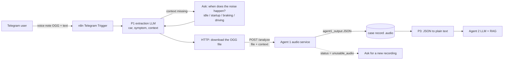
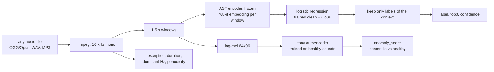

# Agent 1 — integration guide (for groups B and C)

Agent 1 turns an engine sound into a structured fault hypothesis. It is **not an LLM**: it is a
FastAPI service. n8n calls it once per case; its JSON is stored in the case record and given to
Agent 2 as text (prompt P3). The LLMs never receive audio.

## 1. Where it sits



Inside the service:



## 2. The call (n8n HTTP Request node)

| Setting | Value |
|---|---|
| Method / URL | `POST http://audio-service:8001/analyze` (inside Docker) or `http://localhost:8001/analyze` |
| Body | **Form-Data** |
| field `file` | *n8n Binary File*: the binary from the Telegram download node. Send the OGG as is, no conversion needed |
| field `context` | `idle`, `startup`, `braking`, `driving` or `unknown` |
| Timeout | 30 s; retry once. CPU time ≈ 1-2 s per second of audio in real mode |
| On error | continue with text only and tell the user (ARCHITECTURE.md §7) |

`context` matters: it improves macro-F1 by ~2 points on clean audio and **~10 points on Telegram
audio** (0.583 → 0.685). Ask it with Telegram buttons if the text does not say it.

HTTP errors: `400` empty file, `413` file > 20 MB, `422` file cannot be decoded.

## 3. The answer — `contracts/agent1_output.schema.json`

```json
{
  "status": "ok",
  "label": "belt",
  "context": "idle",
  "top3": [{"label": "belt", "prob": 0.71}, {"label": "power_steering", "prob": 0.17},
           {"label": "normal", "prob": 0.06}],
  "anomaly_score": 0.93,
  "confidence": "medium",
  "description": {"duration_s": 9.6, "dominant_freq_hz": 2850.0, "periodic": false,
                  "period_ms": null, "summary": "9.6 s recording, high-pitched sound (dominant 2850 Hz), no clear rhythm."},
  "model_version": "ast-logreg-augmented-opus+anomaly:autoencoder",
  "warnings": []
}
```

| Field | Meaning | How to use it |
|---|---|---|
| `status` | `ok` or `unusable_audio` (shorter than 1.5 s or undecodable) | `unusable_audio` → ask for a new 5-10 s recording, engine bay, no talking |
| `label` | most likely class among the **12 trained ones** (`contracts/labels.json`) | a hypothesis, never a verdict |
| `top3` | 3 best classes with probabilities (sum ≤ 1) | Agent 2 builds checks that separate them |
| `confidence` | `high` (top ≥ 0.70 and margin ≥ 0.30), `medium` (top ≥ 0.45), `low` | `low` → Agent 2 relies on the user's checks more than on the audio |
| `anomaly_score` | how unusual the sound is vs **healthy** recordings, as a percentile (0.5 = typical healthy sound) | see rules below |
| `description` | plain facts computed without a model | can be quoted to the user |
| `warnings` | e.g. unknown context, low confidence | pass to Agent 2 |

### Decision rules for Agent 2 (prompt P4)

| Situation | Meaning | What Agent 2 should do |
|---|---|---|
| `label` is a fault and `anomaly_score` ≥ 0.80 | both models agree | start from `top3` |
| `label` is `normal*` and `anomaly_score` < 0.80 | probably healthy | ask whether the noise is intermittent; suggest recording again when it happens |
| `label` is `normal*` but `anomaly_score` ≥ 0.95 | unusual sound **outside the 12 classes** | consider the hypothesis classes (knock is trained; timing chain, wheel bearing, exhaust leak, turbo, alternator, starter, CV joint, diesel injector are not) and check them with questions |
| `confidence` = `low` | audio not conclusive | rely on the symptom text + checks |

Hypothesis classes (not trained, too few recordings) are listed in `contracts/labels.json`
(every label not reaching `min_recordings`); Agent 1 never outputs them.

## 4. Prompt P3 — giving the result to the LLM

Never paste raw probabilities without explanation: the LLM over-interprets them. Suggested
template (n8n Set/Code node, owner B2):

```text
AUDIO ANALYSIS (automatic, may be wrong):
- Most likely sound class: {{label_fr}} (probability {{top3[0].prob*100}} %, confidence {{confidence}}).
- Other possibilities: {{top3[1].label_fr}} ({{..}} %), {{top3[2].label_fr}} ({{..}} %).
- Unusualness compared with healthy engines: {{anomaly_score >= 0.95 ? "very high" : anomaly_score >= 0.8 ? "high" : "normal range"}}.
- Measured facts: {{description.summary}}
Treat this as a hypothesis to verify with the user's checks, never as a diagnosis.
The audio model only knows 12 classes; other faults are possible.
```

`label_fr` comes from `contracts/labels.json` (field `fr`).

## 5. Run it

```bash
# mock mode (default): returns contracts/examples/agent1_output.json
docker compose up audio-service

# real mode: put agent1_ast.joblib and agent1_ae.pt in models/, then in .env:
#   AGENT1_REAL=true   (installs torch in the image)
#   AGENT1_MOCK=false
docker compose up --build audio-service
```
First real call downloads the AST weights (~350 MB) into `hf_cache/`; later calls are fast.
Swagger UI to try it by hand: http://localhost:8001/docs

## 6. Performance to quote (test set split by recording)

| | macro-F1 | accuracy |
|---|---|---|
| MFCC baseline | 0.616 | 70.2 % |
| AST, clean audio | 0.717 | 78.8 % |
| AST + context, clean audio | 0.739 | 80.3 % |
| AST + context, Telegram-like Opus 16k (before augmentation) | 0.685 | — |
| AST + context, Opus 16k after augmentation | see `results/ast_augment.json` | |

Anomaly detection AUC (fault vs healthy): conv autoencoder **0.865**, MFCC + Isolation Forest
0.822, AST + Isolation Forest 0.811.

Known limits: 12 classes only; few recordings for tappet and knock; labels from the datasets'
authors and some YouTube owners (not all mechanics); startup sounds get higher anomaly scores
than idle sounds even when healthy.
